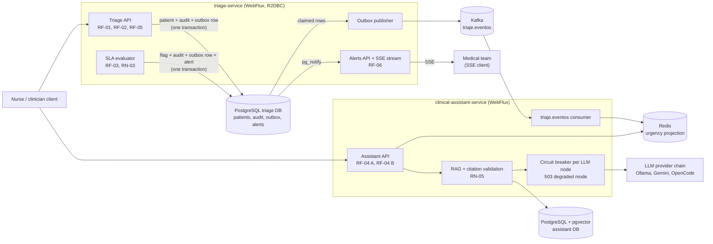

# VidaCruz Triage Platform — local demo

One command starts both services and their infrastructure on `localhost`. No Azure subscription, public URL, or LLM provider key is needed for RF-01/RF-02/RF-03/RF-05/RF-06; RF-04 needs a reachable provider or demonstrates the documented 503 fallback.

## Run it

Prerequisites: Docker with Compose v2. Nothing else is installed on the host.

```bash
cp .env.example .env          # optional: local overrides
docker compose up -d --build  # first build downloads Gradle deps and both JDK images
docker compose ps
```

| Service | URL | Auth |
|---|---|---|
| Triage API | `http://localhost:8081` | `X-API-Key: test-triage-key` |
| Clinical Assistant API | `http://localhost:8082` | `X-API-Key: test-assistant-key` |
| Health (public) | `http://localhost:8081/actuator/health`, `http://localhost:8082/actuator/health` | none |
| PostgreSQL (triage) | `localhost:5432` | `triage_app` / `triage_local` |
| PostgreSQL + pgvector (assistant) | `localhost:5433` | `assistant_app` / `assistant_local` |
| Kafka | `localhost:9092` | topic `triaje.eventos` |
| Redis | `localhost:6379` | urgency projection |
| Prometheus | `http://localhost:9090` | scraper sends the demo keys |
| Grafana | `http://localhost:3000` | anonymous viewer; local admin password `admin-local` |
| Jaeger | `http://localhost:16686` | local traces from both services |

Stop with `docker compose down`; keep data with `docker compose down` (volumes persist) or delete it with `docker compose down -v`.

## First request

```bash
curl -s http://localhost:8081/actuator/health
curl -s -i http://localhost:8081/triage/alertas \
  -H 'X-API-Key: wrong'          # 401, body {code, message, correlationId}
curl -s http://localhost:8081/triage/alertas \
  -H 'X-API-Key: test-triage-key'  # 200, []
```

Missing or wrong keys return `401` with `{"code":"UNAUTHORIZED","message":"Invalid or missing X-API-Key header","correlationId":"..."}`. Keys come from `TRIAGE_API_KEY` / `ASSISTANT_API_KEY`. The values above are Docker Compose defaults for localhost only: the services themselves have no default and refuse to start without a key. See `docs/adr/ADR-07-authentication-api-key.md`.

## Local verification checklist

Run in order. Details and ready-to-import requests are in [`docs/demo/local-verification.md`](docs/demo/local-verification.md) and [`postman/`](postman/).

- [ ] Both `/actuator/health` endpoints return `{"status":"UP"}`.
- [ ] `POST /triage/pacientes` with E1…E6 returns `201` and the expected `nivel` (`CRITICO`, `URGENTE`, `URGENTE_2`, `NO_URGENTE`, `NO_URGENTE_2`, `CRITICO`).
- [ ] `GET /triage/pacientes/{id}` and `PATCH /triage/pacientes/{id}/estado` with `{"estado":"EN_CONSULTA"}` then `{"estado":"ALTA"}`.
- [ ] RF-03: wait for the short demo SLA, then `GET /triage/alertas` shows a `PENDIENTE` alert; changing state resolves it.
- [ ] `POST /triage/alertas/{id}/reconocimiento` with `{"responsable":"..."}` moves it to `RECONOCIDA`; a second call returns `TRG-009`.
- [ ] `GET /triage/alertas/stream` pushes the initial snapshot and live changes (use `curl -N` or streaming `fetch`).
- [ ] `GET /triage/reportes/operacion?desde=...&hasta=...` with ISO 8601 offsets (`2026-01-01T00:00:00Z`).
- [ ] RF-04: `POST /asistente/consulta` returns an answer with the fixed notice, or `503` with `LLM_UNAVAILABLE` when no provider is configured.
- [ ] `GET /asistente/estado-urgencias` reflects patients published through `triaje.eventos` (outbox publisher is enabled in Compose).
- [ ] NFR-07: `/actuator/prometheus` on both services needs `X-API-Key`, and Prometheus (`localhost:9090`) plus the provisioned Grafana dashboard (`localhost:3000`) show the counters after the requests above.
- [ ] NFR-16: a registration with a W3C `traceparent` header produces one trace across `triage-service` and `clinical-assistant-service` in Jaeger (`localhost:16686`).

## Known limits

- **Deployment artifacts.** The AKS manifests live in `triage-service/deployment/k8s/`, `clinical-assistant-service/deployment/k8s/` and `infra/k8s/`; the Azure IaC is in `infra/azure/`, and the CI/deploy workflows are in `.github/workflows/`. The validated target is recorded in [ADR-12](docs/adr/ADR-12-aks-deployment.md). No credentials are stored here, and local traces still go to the Jaeger container.
- **Azure deployment status.** There is **no live public URL**. The AKS deployment was validated on 2026-11-26 at `https://vidacruz-l7rsr6.northcentralus.cloudapp.azure.com`:
  - `401 TRG-005` without a key, so the API-key filter is enforced end to end.
  - `200` on the OpenAPI document and the Swagger UI.
  - Gateway `Programmed` and TLS certificate `Ready`.
  - Triage `2/2` pods.

  The resource group no longer exists: deleting it once the evidence was recorded was the planned step to bring the cost of the Azure for Students subscription to zero. On 2026-11-27 the host no longer resolves. The evidence is in [`docs/operations/despliegue-azure-y-pruebas.md`](docs/operations/despliegue-azure-y-pruebas.md) (sections 2.2 and 2.3). To reproduce the deployment, run `infra/azure/provision.ps1` and then the `deploy.yml` workflow. A new deployment gets a new DNS suffix, so the URL changes.
- **RF-04 compatibility alias.** `POST /rag` remains available as a compatibility alias for existing clients; new clients should use `POST /asistente/consulta`.
- **RF-04 provider.** The default chain targets Ollama at `http://ollama:11434`; the `ollama` Compose profile does not auto-pull a model. Without a reachable provider, expect the fixed 503 notice.
- **SSE and browsers.** `EventSource` cannot send `X-API-Key`. Use streaming `fetch` with the header, `curl -N`, or a backend proxy (ADR-15).
- **Idempotent registration is opt-in.** `POST /triage/pacientes` accepts an optional `Idempotency-Key` header: the same key with the same body replays the original `201`, and the same key with a different body returns `409`. Without the header, every call creates a new patient ([ADR-12 (Idempotency)](docs/adr/ADR-12-idempotency-key.md)).
- **Report range.** `hasta` in `GET /triage/reportes/operacion` is an inclusive calendar day in UTC: the report covers up to the end of that day.
- **E2E tests.** Local Testcontainers has no usable Docker socket in this environment; CI runs the full suite including PostgreSQL LISTEN/NOTIFY.

## Architecture

Two reactive services that never call each other synchronously. They integrate only through the `triaje.eventos` topic, so the triage service keeps working when the assistant or the LLM is down.



More views (registration sequence, escalation race guard, state machine, event flow, RAG flow, breaker states) are in [`docs/architecture/diagrams.md`](docs/architecture/diagrams.md).

### Technologies

| Area | Choice |
|---|---|
| Runtime | Java 21, Spring Boot 3.5.16, Spring WebFlux, Project Reactor |
| Persistence | PostgreSQL 16, R2DBC (triage), Flyway; pgvector over JDBC on a bounded scheduler (assistant) |
| Messaging | Kafka, topic `triaje.eventos`, JSON events with an envelope (`eventType`, `eventId`, `schemaVersion`, `pacienteId`, `pacienteSequence`, `occurredAt`, `correlationId`), keyed by patient id |
| Projection | Redis with atomic Lua scripts |
| Resilience | Resilience4j circuit breaker and timeout per LLM node, failover chain, `503 LLM_UNAVAILABLE` fallback |
| Observability | Actuator health/readiness probes, Micrometer + Prometheus + Grafana, OpenTelemetry traces to Jaeger, structured JSON logs with `correlationId`, `traceId` and `spanId` |
| Security | `X-API-Key` on every endpoint except health, keys from environment variables |
| Tests | JUnit 5, Reactor `StepVerifier`, Testcontainers (PostgreSQL, Kafka, pgvector), BlockHound |
| Deployment | Docker Compose (local), AKS with Kustomize manifests, Bicep IaC, GitHub Actions |

### Key decisions

| Decision | Why | ADR |
|---|---|---|
| Two services, integrated only by events | The triage flow must not depend on the assistant or the LLM | [ADR-01](docs/adr/ADR-01-service-decomposition.md) |
| Transactional outbox | A state change and its event commit together, so no event is lost or invented | [ADR-03](docs/adr/ADR-03-transactional-outbox.md) |
| Conditional `UPDATE` for escalation | Escalate once (RN-03), even with several replicas evaluating at the same time | [ADR-13](docs/adr/ADR-13-sla-evaluation.md) |
| RF-06 alerts as persisted rows streamed over SSE | An alert exists if and only if the escalation committed; no external receiver needed | [ADR-15](docs/adr/ADR-15-persisted-sse-alerts.md) |
| pgvector as vector store | Same PostgreSQL engine; JDBC isolated off the event loop | [ADR-04](docs/adr/ADR-04-pgvector-jdbc-isolation.md) |
| Citation validation against corpus and retrieved set | RN-05: no answer without a valid source; no LLM call when nothing relevant is retrieved | [Clinical Assistant service doc](docs/services/clinical-assistant-service.md) (RN-05) |
| Circuit breaker with 503 degraded mode | A failing LLM yields a clear 503 instead of timeouts | [ADR-09](docs/adr/ADR-09-circuit-breaker-degraded-mode.md) |
| Redis urgency projection rebuilt from Kafka | RF-04 B without calling the triage API | [ADR-08](docs/adr/ADR-08-urgency-projection-store.md) |
| API key authentication | Simple service-to-service auth; JWT rejected for this scope | [ADR-07](docs/adr/ADR-07-authentication-api-key.md) |
| One database per service | Clear data ownership; no shared schema | [ADR-14](docs/adr/ADR-14-database-ownership-one-db-per-service.md) |

The full list, with status and where each decision is implemented, is in [`docs/adr/README.md`](docs/adr/README.md). Services are documented in [`docs/services/`](docs/services/) and requirements in [`docs/requirements.md`](docs/requirements.md).

Release flow: `develop` -> `release/vX.Y.Z` -> PR to `main` -> tag `vX.Y.Z`. See [`docs/operations/release-policy.md`](docs/operations/release-policy.md).

**Production note:** Boot 3.5.16 reached EOL on 2026-06-30. Production requires commercial Spring support or a migration to Boot 4.1+ (ADR-10).
