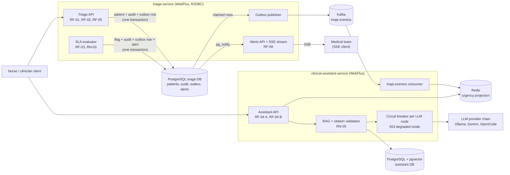

# VidaCruz Triage Platform — local demo

One command starts both services and their infrastructure on `localhost`. No Azure subscription, public URL, or LLM provider key is needed for RF-01/RF-02/RF-03/RF-05/RF-06; RF-04 needs a reachable provider or demonstrates the documented 503 fallback.

## Run it

Prerequisites: Docker with Compose v2. Nothing else is installed on the host.

```bash
cp .env.example .env          # optional: local overrides
docker compose up -d --build  # first build downloads Gradle deps and both JDK images
docker compose ps
```

For a fast RF-03/RF-06 demo (SLA escalation/alerts without waiting the normal CRITICO SLA), use the demo override:

```bash
docker compose -f docker-compose.yml -f docker-compose.demo.yml up -d --build
```

`docker-compose.demo.yml` is optional and only changes `triage-service`: `SLA_CRITICO_MINUTES=1` and `TRIAGE_SLA_EVALUATION_INTERVAL_MS=5000`. Use the base command for normal/default behavior.

| Service | URL | Auth |
|---|---|---|
| Triage API | `http://localhost:8081` | `X-API-Key: test-triage-key` |
| Clinical Assistant API | `http://localhost:8082` | `X-API-Key: test-assistant-key` |
| Health (public) | `http://localhost:8081/actuator/health`, `http://localhost:8082/actuator/health` | none |
| PostgreSQL (triage) | `localhost:5432` | `triage_app` / `triage_local` |
| PostgreSQL + pgvector (assistant) | `localhost:5433` | `assistant_app` / `assistant_local` |
| Kafka | `localhost:9092` | topic `triaje.eventos` |
| Redis | `localhost:6379` | urgency projection |
| Prometheus | `http://localhost:9090` | scraper sends the demo keys |
| Grafana | `http://localhost:3000` | anonymous viewer; local admin password `admin-local` |
| Jaeger | `http://localhost:16686` | local traces from both services |

Stop with `docker compose down`; keep data with `docker compose down` (volumes persist) or delete it with `docker compose down -v`.

## First request

```bash
curl -s http://localhost:8081/actuator/health
curl -s -i http://localhost:8081/triage/alertas \
  -H 'X-API-Key: wrong'          # 401, body {code, message, correlationId}
curl -s http://localhost:8081/triage/alertas \
  -H 'X-API-Key: test-triage-key'  # 200, []
```

Missing or wrong keys return `401` with `{"code":"UNAUTHORIZED","message":"Invalid or missing X-API-Key header","correlationId":"..."}`. Keys come from `TRIAGE_API_KEY` / `ASSISTANT_API_KEY`. The values above are Docker Compose defaults for localhost only: the services themselves have no default and refuse to start without a key. See `docs/adr/ADR-07-authentication-api-key.md`.

### API keys and scopes

Every request except the health probes needs `X-API-Key`. Each key has scopes, and each route needs one:

| Service | Route | Scope |
|---|---|---|
| Triage | `GET /triage/**` (patients, alerts, SSE stream, reports) | `triage:read` |
| Triage | `POST`/`PATCH /triage/**` (registration, state, acknowledgement) | `triage:write` |
| Assistant | `POST /asistente/consulta`, `POST /rag`, `GET /asistente/estado-urgencias`, `GET /clinical/corpus/retrieve` | `assistant:query` |
| Assistant | `POST /clinical/corpus/ingest` | `corpus:admin` |
| Both | `/actuator/**` except health | `metrics:read` |

A valid key without the route's scope gets `403` with `{"code":"FORBIDDEN",...}`; unknown routes are denied. Three kinds of key, all optional except the owner key:

- **Owner key**: `TRIAGE_API_KEY` / `ASSISTANT_API_KEY`. It always has every scope, so existing setups need no change.
- **Reviewer (evaluator) key**: `TRIAGE_REVIEWER_API_KEY` (`triage:read` + `triage:write`) and `ASSISTANT_REVIEWER_API_KEY` (`assistant:query`, **no** `corpus:admin`). Give these to external evaluators; unset them to revoke access without touching the owner key.
  - Compose: put them in `.env` and run `docker compose up -d`.
  - Kubernetes: add them to the `triage-service-secrets` / `clinical-assistant-service-secrets` Secrets (see `*/deployment/k8s/secret.example.yaml`).
  - Azure: the same names as GitHub secrets of the `azure` environment, once the deploy workflow passes them through (separate change). A service started without them runs with the owner key only.
- **Extra scoped keys**: `TRIAGE_API_KEYS` / `ASSISTANT_API_KEYS`, entries `id|scope,scope|key` separated by `;`, for example `dashboard|triage:read|<key>`.

Only key ids (`owner`, `reviewer`, or your own id) are logged. Every `GET /triage/pacientes/{id}` writes one line on the `audit.phi` logger with the key id, patient id, status and correlation id. The public routes are open to any IP: there is no IP allow-list and no rate limit.

## Local verification checklist

Run in order. Details and ready-to-import requests are in [`docs/demo/local-verification.md`](docs/demo/local-verification.md) and [`postman/`](postman/).

- [ ] Both `/actuator/health` endpoints return `{"status":"UP"}`.
- [ ] `POST /triage/pacientes` with E1…E6 returns `201` and the expected `nivel` (`CRITICO`, `URGENTE`, `URGENTE_2`, `NO_URGENTE`, `NO_URGENTE_2`, `CRITICO`).
- [ ] `GET /triage/pacientes/{id}` and `PATCH /triage/pacientes/{id}/estado` with `{"estado":"EN_CONSULTA"}` then `{"estado":"ALTA"}`.
- [ ] RF-03: with the demo override (`docker compose -f docker-compose.yml -f docker-compose.demo.yml up -d --build`), wait for the short CRITICO SLA, then `GET /triage/alertas` shows a `PENDIENTE` alert; changing state resolves it.
- [ ] `POST /triage/alertas/{id}/reconocimiento` with `{"responsable":"..."}` moves it to `RECONOCIDA`; a second call returns `TRG-009`.
- [ ] `GET /triage/alertas/stream` pushes the initial snapshot and live changes (use `curl -N` or streaming `fetch`).
- [ ] `GET /triage/reportes/operacion?desde=...&hasta=...` with ISO 8601 offsets (`2026-01-01T00:00:00Z`).
- [ ] RF-04: `POST /asistente/consulta` returns an answer with the fixed notice, or `503` with `LLM_UNAVAILABLE` when no provider is configured.
- [ ] `GET /asistente/estado-urgencias` reflects patients published through `triaje.eventos` (outbox publisher is enabled in Compose).
- [ ] NFR-07: `/actuator/prometheus` on both services needs `X-API-Key`, and Prometheus (`localhost:9090`) plus the provisioned Grafana dashboard (`localhost:3000`) show the counters after the requests above.
- [ ] NFR-16: a registration with a W3C `traceparent` header produces one trace across `triage-service` and `clinical-assistant-service` in Jaeger (`localhost:16686`).

## Evaluator map

For the technical-test review, start here:

| What to review | Where |
|---|---|
| One-command local run | This README (`Run it`) + `docker-compose.yml` |
| Architecture diagram and flows | `Architecture` section below + [`docs/architecture/diagrams.md`](docs/architecture/diagrams.md) |
| Key decisions and justification | `Key decisions` section below + [`docs/adr/README.md`](docs/adr/README.md) |
| Functional/non-functional requirements | [`docs/requirements.md`](docs/requirements.md) |
| Test coverage / local verification | [`docs/demo/local-verification.md`](docs/demo/local-verification.md), [`postman/`](postman/), service `src/test` trees |
| Enunciado compliance matrix | [`docs/demo/enunciado-compliance-matrix.md`](docs/demo/enunciado-compliance-matrix.md) |
| Kubernetes / Azure IaC | `infra/k8s/`, `triage-service/deployment/k8s/`, `clinical-assistant-service/deployment/k8s/`, `infra/azure/` |
| Azure deployment evidence | [`docs/operations/despliegue-azure-y-pruebas.md`](docs/operations/despliegue-azure-y-pruebas.md) |

### Verifying the Azure deployment from any machine

When the Azure environment is up, health, readiness and metrics are reachable from any IP under `/ops` on the public host (no IP allow-list). Health needs no key and shows only the status; `/prometheus` needs `X-API-Key`. Evaluators get a separate, revocable reviewer key through a secure channel.

```bash
HOST=<public host printed by deploy.ps1>
curl -s https://$HOST/ops/triage/health/readiness
curl -s https://$HOST/ops/asistente/health/liveness
curl -s -H "X-API-Key: $REVIEWER_KEY" https://$HOST/ops/triage/prometheus | head
curl -s -H "X-API-Key: $REVIEWER_KEY" https://$HOST/ops/asistente/prometheus | head
```

The route table and the manual GitHub settings (a single protected environment `azure` for deployment and the real-provider verifications, optional `*_REVIEWER_API_KEY` secrets) are in [`docs/operations/despliegue-azure-y-pruebas.md`](docs/operations/despliegue-azure-y-pruebas.md) (sections 1.8 and 1.9).

## Security decisions

Owner decisions from the 2026-11-27 security review that are **not in `main` yet** (merged into `develop`, open PRs or GitHub settings). Guiding rule: the evaluators must be able to test every scenario from any machine, so access is controlled by API keys and never by IP allow-lists.

**Accepted risks (kept on purpose for testability)**

| Decision | Why | Mitigation |
|---|---|---|
| Public routes `/triage` and `/asistente` open to any IP | The deliverable requires reachable APIs, and evaluator IPs are unknown | Every call needs `X-API-Key`; evaluators get a separate, revocable reviewer key without `corpus:admin` |
| Health and readiness without a key (`/ops/.../health`) | Evaluators can check the deployment from outside | Only `UP`/`DOWN` is shown (`show-details: never`); metrics still need the key |
| Local defaults in `docker-compose.yml`, `k8s/local`, Postman and Grafana | `docker compose up` must work with no environment variables | Local only: `deploy.ps1` requires real secrets for Azure |
| Kafka and Redis without TLS in local environments | Same one-command local run | Local only; TLS for Azure is a deferred improvement |
| Public Swagger and OpenAPI paths | Evaluators can explore the contract | The contract is public, but every operation still needs the key |
| AKS API server without authorized IP ranges (B-8) | Authorized ranges would block GitHub-hosted runners | Entra ID + Azure RBAC and `disableLocalAccounts` |

**Status (2026-11-28)**

| Item | Where | Status |
|---|---|---|
| M-1 … M-6: prompt delimiters and grounding check, scoped keys with reviewer keys and PHI read audit, no unscoped CI permissions, Dependabot + report-only Trivy, PII redaction before cloud LLMs, default-deny NetworkPolicies | PR #173 | Merged into `develop`; not released to `main` yet. *Security improvements (backlog)* lists what each item leaves for later |
| A-1 / A-2 (partial): no default keys in `application.yaml`; the reviewer key cannot ingest corpus | PR #173 | Merged into `develop`; not released to `main` yet |
| One protected environment `azure` for deployment and the real-provider verifications | PR #184 | Merged into `develop`; not released to `main` yet. GitHub side applied: branches `develop`/`main` only, required reviewer, the seven secrets inside `azure`, legacy *Free models probe* and *OpenCode status probe* workflows disabled |
| M-5 gap: PII redaction also for the optional OpenRouter node | PR #189 | Open |
| Remove the repository-level copies of the seven secrets, then the empty `gemini-verification` and `openrouter-verification` environments | GitHub settings | Pending. Unblocked: every workflow on `develop` that reads secrets now uses `azure` |

**Deferred improvements**

| Finding | Improvement |
|---|---|
| A-2 | Reserve protocol codes and add a `trusted` flag to ingested documents, so an ingested document cannot impersonate an official protocol citation |
| A-3 | Kafka SASL_SSL and event signing; enforce the NetworkPolicies (Azure CNI powered by Cilium) |
| A-4 | One least-privilege PostgreSQL user per service, `sslmode=verify-full` and private networking instead of `publicNetworkAccess: Enabled` |
| B-1 | Bind Compose ports to `127.0.0.1` through a `BIND_ADDRESS` variable (evaluators can still use `0.0.0.0`); Redis password and a non-default Grafana password locally |
| B-2 | Range limit on the legacy `/triage/reports/*` endpoints |
| B-3 | Validate `X-Correlation-Id` (format and length) before echoing and logging it |
| B-4 | Size and rate limits on corpus ingestion to cap embedding costs |
| B-5 | Remove Azure identifiers and personal data from versioned documentation |
| B-6 | Remove dead scaffolding that can be mistaken for the real code |

## Known limits

- **Deployment artifacts.** The AKS manifests live in `triage-service/deployment/k8s/`, `clinical-assistant-service/deployment/k8s/` and `infra/k8s/`; the Azure IaC is in `infra/azure/`, and the CI/deploy workflows are in `.github/workflows/`. The validated target is recorded in [ADR-12](docs/adr/ADR-12-aks-deployment.md). No credentials are stored here, and local traces still go to the Jaeger container.
- **Azure deployment status.** Submission URL provided: `https://vidacruz-l7rsr6.northcentralus.cloudapp.azure.com/docs/triage/swagger-ui/index.html#/Pacientes/registrarPaciente`. An unauthenticated probe to the Swagger UI returned `401`, which indicates the gateway and API-key filter are reachable; authenticated API verification requires the `X-API-Key` shared through a secure channel (**do not commit keys**). Historical deployment evidence is in [`docs/operations/despliegue-azure-y-pruebas.md`](docs/operations/despliegue-azure-y-pruebas.md). Availability can change because the environment is cost-controlled; to reproduce, run `infra/azure/provision.ps1` and then the `deploy.yml` workflow. A new deployment gets a new DNS suffix, so the URL changes.
- **RF-04 compatibility alias.** `POST /rag` remains available as a compatibility alias for existing clients; new clients should use `POST /asistente/consulta`.
- **RF-04 provider.** The default chain targets Ollama at `http://ollama:11434`; the `ollama` Compose profile does not auto-pull a model. Without a reachable provider, expect the fixed 503 notice.
- **SSE and browsers.** `EventSource` cannot send `X-API-Key`. Use streaming `fetch` with the header, `curl -N`, or a backend proxy (ADR-15).
- **Idempotent registration is opt-in.** `POST /triage/pacientes` accepts an optional `Idempotency-Key` header: the same key with the same body replays the original `201`, and the same key with a different body returns `409`. Without the header, every call creates a new patient ([ADR-12 (Idempotency)](docs/adr/ADR-12-idempotency-key.md)).
- **Report range.** `hasta` in `GET /triage/reportes/operacion` is an inclusive calendar day in UTC: the report covers up to the end of that day.
- **E2E tests.** Local Testcontainers has no usable Docker socket in this environment; CI runs the full suite including PostgreSQL LISTEN/NOTIFY.

## Security improvements (backlog)

Items from the 2026-11-27 security review that were deliberately not done in the M-1…M-6 change, with the reason and the next step.

| Finding | Item | Why it is deferred | Next step |
|---|---|---|---|
| M-1 | Strict grounding (`[n]` required, overlap on every answer, numbers must appear in the evidence) | Real providers do not always emit markers, and the Ollama fixture cannot pass the stricter checks; enabling them by default would turn valid answers into the no-protocol notice. The default only requires a marker **or** 20% lexical overlap. | Measure provider answers, then enable `RAG_GROUNDING_REQUIRE_MARKERS`, `RAG_GROUNDING_MIN_LEXICAL_OVERLAP` and `RAG_GROUNDING_NUMBERS_IN_EVIDENCE`. Show "verify the cited source" in the UI. |
| M-2 | Rate limiting | Evaluators must reach the public routes from any IP, and the SSE stream is long-lived; a limiter needs tuning so it does not cut either. | Per-key (not per-IP) limit at the Gateway, at least 60 req/min, with SSE excluded. |
| M-4 | SCA in blocking mode | The first Trivy run may find existing HIGH/CRITICAL issues; blocking at once would stop every merge. It runs report-only. | Review the first report, fix or document the findings, then set the repository variable `SCA_BLOCKING=true`. |
| M-4 | Spring Boot 3.5 → a supported line | Out of scope for a security patch; Boot 3.5.16 is past OSS EOL (ADR-10). | Plan the migration to Boot 4.1+ (or commercial support) as its own change. |
| M-5 | PII redaction is a heuristic | Names without a cue ("Juan Pérez llegó…") are not detected. | Run Ollama in the cluster as the first node, or use a paid tier with a DPA and no retention. Do not forward `contexto_paciente` without redaction. |
| M-6 | NetworkPolicy enforcement | `main.bicep` sets no `networkPolicy`, and Docker Desktop/Minikube enforce none by default, so `infra/k8s/network-policies.yaml` is not enforced today. Enabling an engine changes how the cluster is created and could not be verified (Azure environment deleted). | Create the cluster with Azure CNI powered by Cilium (`networkDataplane`/`networkPolicy: cilium`), then verify the Gateway, SSE, Kafka, Redis, PostgreSQL and LLM flows. |
| M-6 | Istio STRICT mTLS (`PeerAuthentication`) | The app-routing Istio only runs the Gateway; without sidecars in `vidacruz`, STRICT mode breaks gateway→pod traffic. | Enable the Istio add-on with sidecar injection in `vidacruz`, then apply `PeerAuthentication` STRICT. |
| M-6 / A-3 | Kafka SASL_SSL, Redis TLS, PostgreSQL `verify-full` | Needs certificates and client configuration in both services; out of scope. | Native TLS for Kafka and Redis (or the mTLS above), plus `sslmode=verify-full` with the Azure CA. |

## Architecture

Two reactive services that never call each other synchronously. They integrate only through the `triaje.eventos` topic, so the triage service keeps working when the assistant or the LLM is down.



More views (registration sequence, escalation race guard, state machine, event flow, RAG flow, breaker states) are in [`docs/architecture/diagrams.md`](docs/architecture/diagrams.md).

### Technologies

| Area | Choice |
|---|---|
| Runtime | Java 21, Spring Boot 3.5.16, Spring WebFlux, Project Reactor |
| Persistence | PostgreSQL 16, R2DBC (triage), Flyway; pgvector over JDBC on a bounded scheduler (assistant) |
| Messaging | Kafka, topic `triaje.eventos`, JSON events with an envelope (`eventType`, `eventId`, `schemaVersion`, `pacienteId`, `pacienteSequence`, `occurredAt`, `correlationId`), keyed by patient id |
| Projection | Redis with atomic Lua scripts |
| Resilience | Resilience4j circuit breaker and timeout per LLM node, failover chain, `503 LLM_UNAVAILABLE` fallback |
| Observability | Actuator health/readiness probes, Micrometer + Prometheus + Grafana, OpenTelemetry traces to Jaeger, structured JSON logs with `correlationId`, `traceId` and `spanId` |
| Security | `X-API-Key` on every endpoint except health, keys from environment variables |
| Tests | JUnit 5, Reactor `StepVerifier`, Testcontainers (PostgreSQL, Kafka, pgvector), BlockHound |
| Deployment | Docker Compose (local), AKS with Kustomize manifests, Bicep IaC, GitHub Actions |

### Key decisions

| Decision | Why | ADR |
|---|---|---|
| Two services, integrated only by events | The triage flow must not depend on the assistant or the LLM | [ADR-01](docs/adr/ADR-01-service-decomposition.md) |
| Transactional outbox | A state change and its event commit together, so no event is lost or invented | [ADR-03](docs/adr/ADR-03-transactional-outbox.md) |
| Conditional `UPDATE` for escalation | Escalate once (RN-03), even with several replicas evaluating at the same time | [ADR-13](docs/adr/ADR-13-sla-evaluation.md) |
| RF-06 alerts as persisted rows streamed over SSE | An alert exists if and only if the escalation committed; no external receiver needed | [ADR-15](docs/adr/ADR-15-persisted-sse-alerts.md) |
| pgvector as vector store | Same PostgreSQL engine; JDBC isolated off the event loop | [ADR-04](docs/adr/ADR-04-pgvector-jdbc-isolation.md) |
| Citation validation against corpus and retrieved set | RN-05: no answer without a valid source; no LLM call when nothing relevant is retrieved | [Clinical Assistant service doc](docs/services/clinical-assistant-service.md) (RN-05) |
| Circuit breaker with 503 degraded mode | A failing LLM yields a clear 503 instead of timeouts | [ADR-09](docs/adr/ADR-09-circuit-breaker-degraded-mode.md) |
| Redis urgency projection rebuilt from Kafka | RF-04 B without calling the triage API | [ADR-08](docs/adr/ADR-08-urgency-projection-store.md) |
| API key authentication | Simple service-to-service auth; JWT rejected for this scope | [ADR-07](docs/adr/ADR-07-authentication-api-key.md) |
| One database per service | Clear data ownership; no shared schema | [ADR-14](docs/adr/ADR-14-database-ownership-one-db-per-service.md) |

The full list, with status and where each decision is implemented, is in [`docs/adr/README.md`](docs/adr/README.md). Services are documented in [`docs/services/`](docs/services/) and requirements in [`docs/requirements.md`](docs/requirements.md).

Release flow: `develop` -> `release/vX.Y.Z` -> PR to `main` -> tag `vX.Y.Z`. See [`docs/operations/release-policy.md`](docs/operations/release-policy.md).

**Production note:** Boot 3.5.16 reached EOL on 2026-06-30. Production requires commercial Spring support or a migration to Boot 4.1+ (ADR-10).
