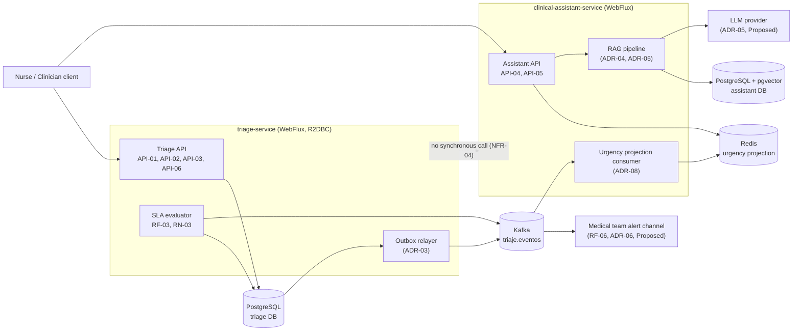
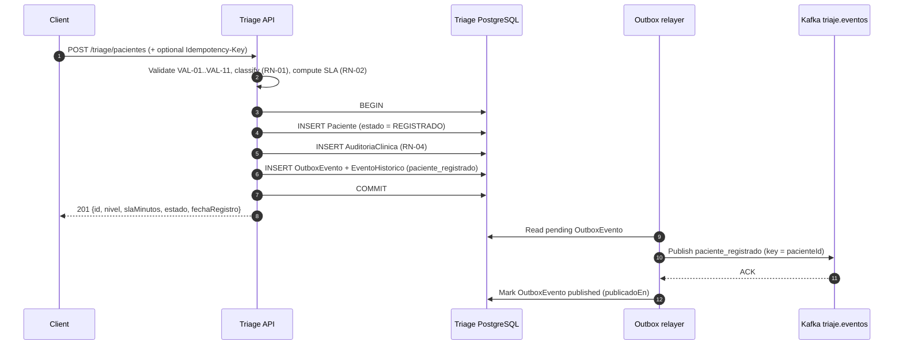
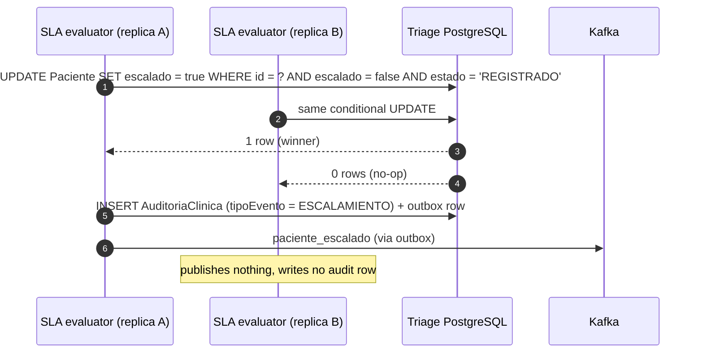
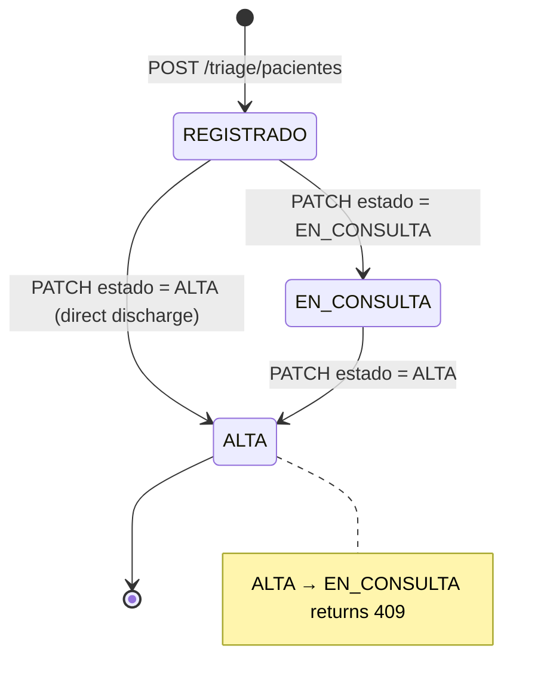
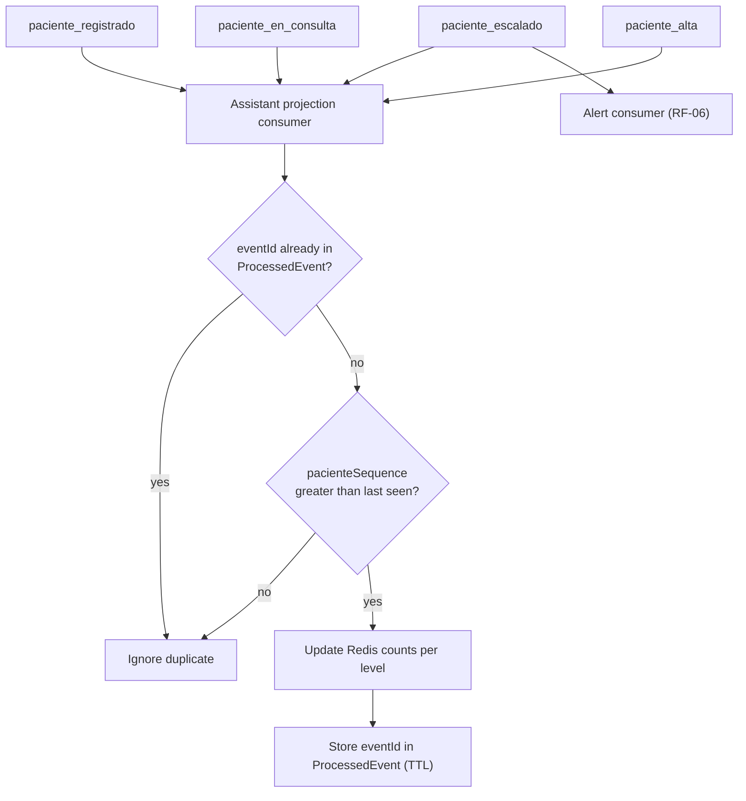
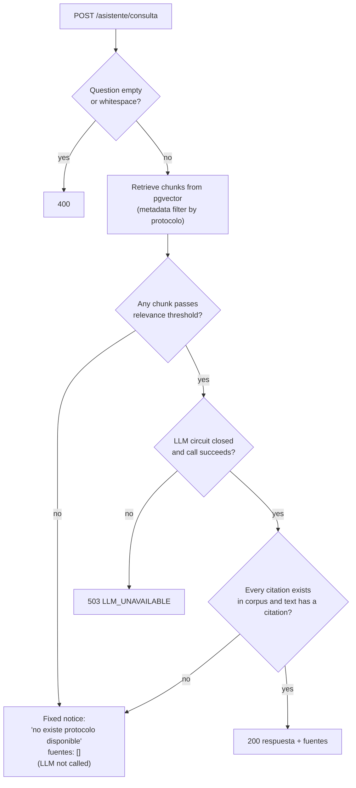
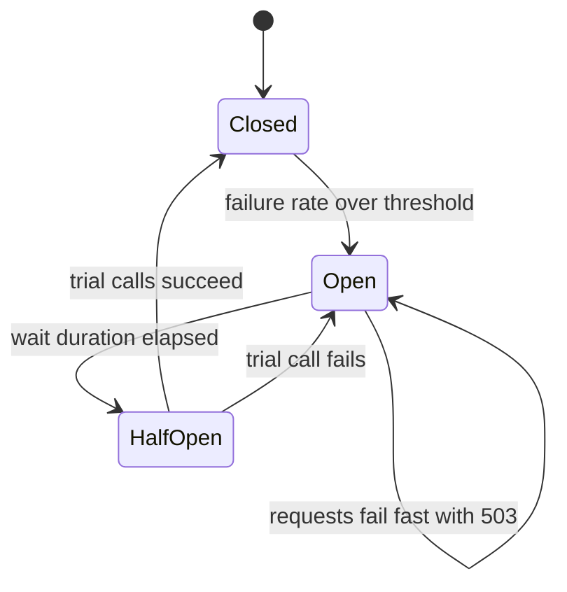
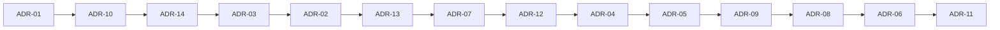

# VidaCruz — Architecture Diagrams

Status: **draft for review.** Diagrams are derived from `docs/requirements.md` (RF, RN, API, EVT, §11 persistence), `docs/adr-roadmap.md` and the service docs. Where a diagram depends on an ADR that is not yet accepted, the label says so.

## 1. Logical architecture

## 2. Patient registration sequence (RF-01, EVT-01)

Notes: the response does not wait for Kafka. Pending events are retried by the relayer. The `Idempotency-Key` path (DEC-15) returns the stored response without a second insert.

## 3. Escalation with concurrency guard (RF-03, RN-03)

## 4. Patient state machine (RF-02, RN-04)

`escalado` is a separate flag. It does not change `estado`.

## 5. Event flow and projection (EVT-01..EVT-04, DER-03)

## 6. RAG query flow (RF-04 A, RN-05)

## 7. Circuit breaker states on LLM calls (NFR-03, ADR-09 Proposed)

## 8. Decision acceptance order

Source: `docs/adr-roadmap.md` §3.3 (line 70). This is an order, not a full dependency graph. The roadmap does not state edges between ADRs; it states which change needs which ADR ("Must be accepted before", §3). All 14 ADRs are currently `Proposed`, except that the scope of ADR-12 was accepted by the user.

